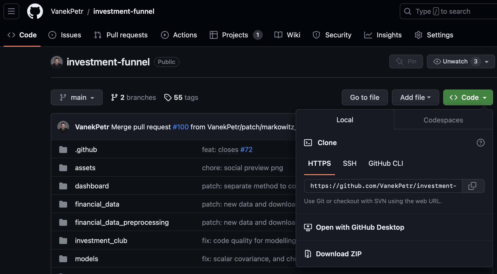

# Practical Financial Optimization 2026

Dear students 🧑‍🎓,

Welcome to the Practical Financial Optimization (PFO) course 🎉.

As part of the curriculum, we will leverage the open-source [Investment Funnel](https://github.com/VanekPetr/investment-funnel) project to move you closer to the real-world applications of mathematical models in finance. Please note that while the course description did not list Python as a prerequisite, **experimenting with the Python code is not compulsory but is shared as a bonus** for those who would like to dig deeper. Most of the models and concepts shown in Python will also be explained and then introduced in GAMS.

If you have any questions, please feel free to contact me at `petrr.vanekk@gmail.com`. Additionally, during the second week of the course, I will provide an introductory lecture on Git and the `Investment Funnel`, where you will have the opportunity to ask questions.

---

## Getting Started with the Investment Funnel

### [I] Explore the Dashboard Application [Highly Recommended]

First and foremost, we **strongly encourage you to explore the `Investment Funnel` dashboard web application**.

➡️ **[https://investment-funnel.algostrata.com](https://investment-funnel.algostrata.com)**

It's very important to familiarize yourself with the application, especially the 'Market overview' tab. The data loaded in the application is **exactly the same data you will be using for your final project**, so understanding its structure now will be a great help later on. The dashboard is best viewed using the Google Chrome browser with adjusted page zoom.

### [II] Understand the Investment Funnel Project Structure

The project was recently split into two main components. Reading through the code of these two projects during the course (perhaps after the first week) may provide valuable hints for your final project.

* **The Dashboard ([Investment Funnel](https://github.com/VanekPetr/investment-funnel) on GitHub)**: This is the repository for the main web application. The `README.md` file in this project is particularly important, as it explains the funnel concept in detail and contains many useful links to the models you will learn about in this course.
* **The Backend Models ([Funnel](https://github.com/VanekPetr/funnel) on GitHub)**: This repository houses the core backend financial models that power the dashboard application. It implements most of the optimization models used throughout the project and provides a deeper look into the underlying financial logic. This project was developed in close collaboration with **Thomas Schmelzer**, an ex-Stanford and ex-ADIA quant with many years of experience. His other projects on his [GitHub profile](https://github.com/tschm) are also well worth exploring.

---

## Optional: For Those Who Want to Go Deeper

This section is for students interested in experimenting with the code on their own machines. The following steps are **entirely optional** and not required to complete the course.

### Running the Projects Locally

If you want to dive deeper and play with the projects on your computer, you can get everything set up locally by following these steps:

1. **Pull the Repositories**: Clone or download the code for both [The Dashboard](https://github.com/VanekPetr/investment-funnel) and [The Backend Models](https://github.com/VanekPetr/funnel) from GitHub. Using Git is highly recommended so you can easily pull the latest updates. You can also download the repository as a ZIP file by clicking the green `Code` button and selecting `Download ZIP`.
    

      </a>
    

2. **Choose a Code Editor**: To efficiently explore and edit the code, download a modern code editor. We highly recommend:
   * **VS Code** or **Cursor**: Light, powerful, and highly customizable.
   * **PyCharm (Community Edition)**: An excellent, free IDE dedicated entirely to Python development.

3. **Follow the READMEs**: Check out the detailed, step-by-step setup and execution instructions provided in the `README.md` file of each repository to get the application running on your machine.